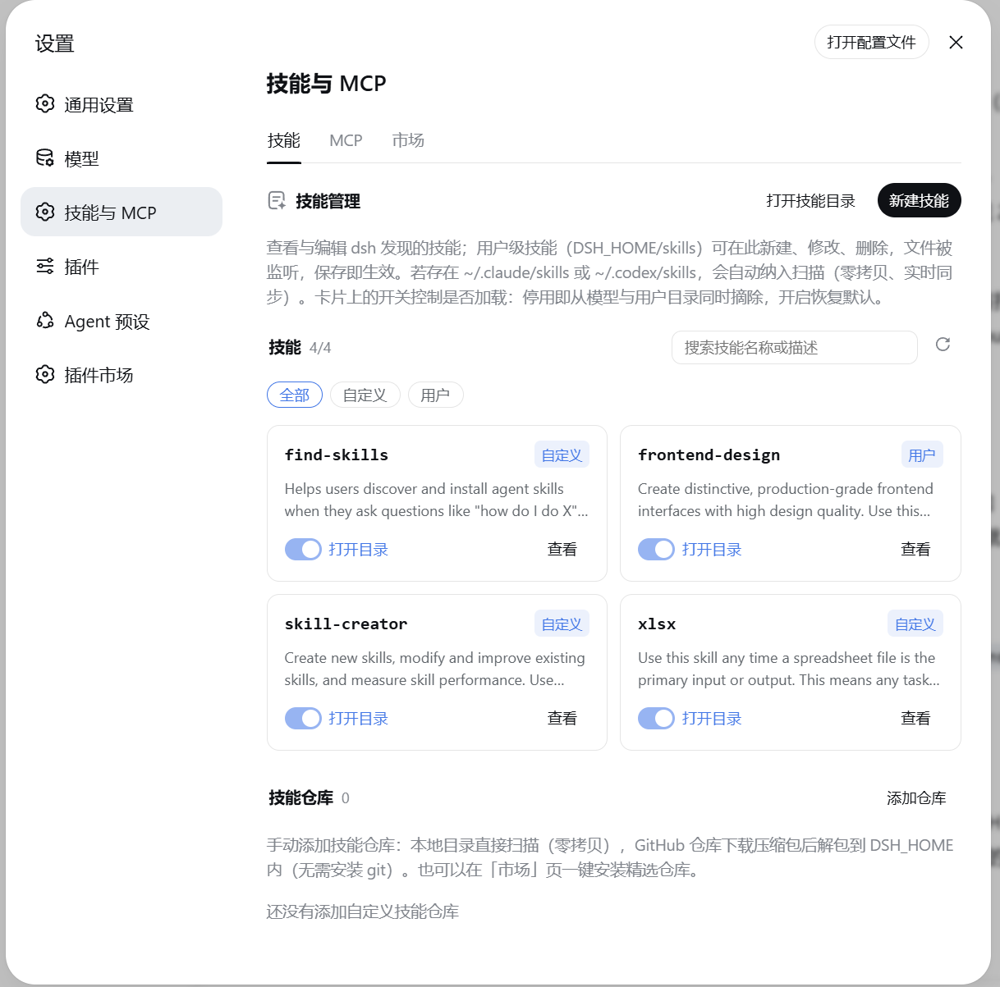
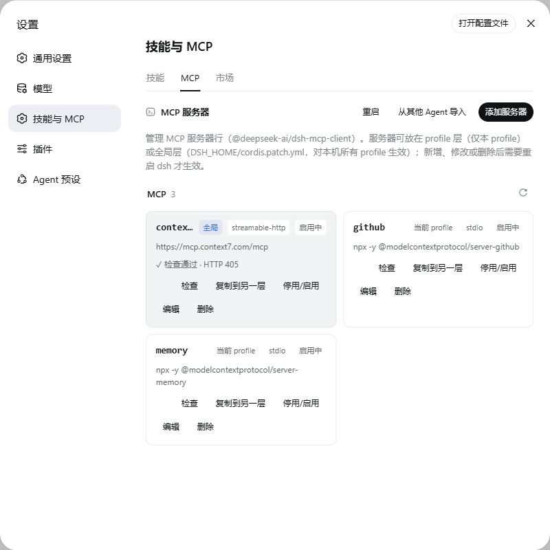
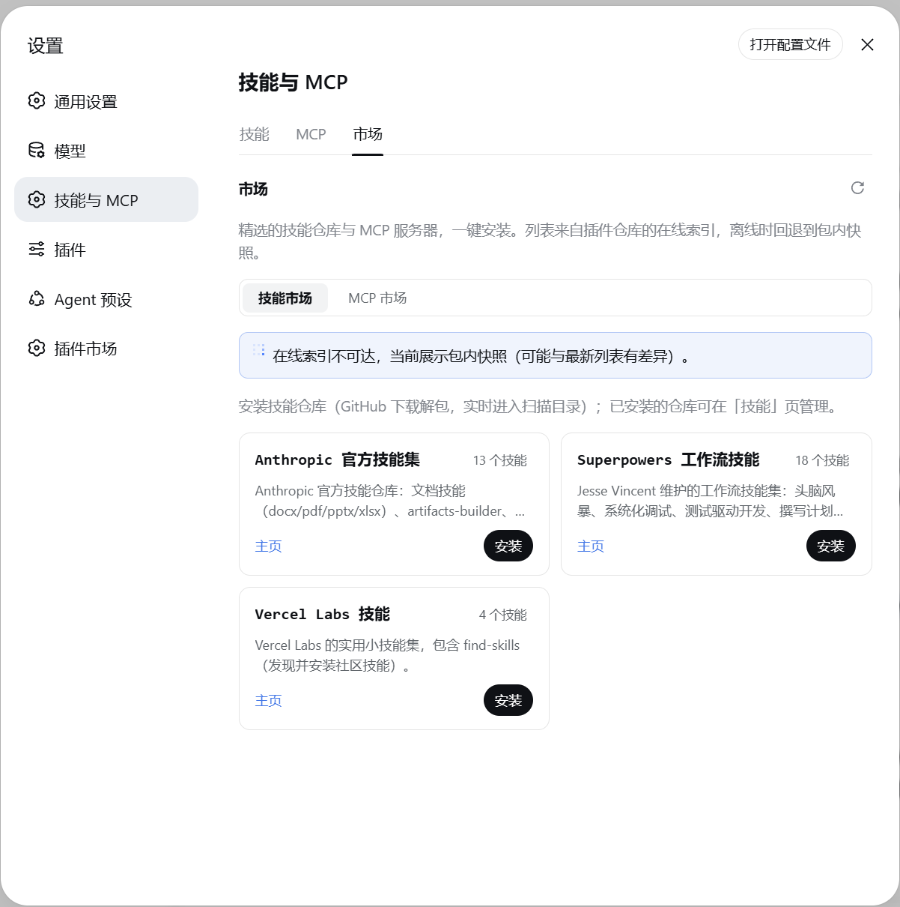
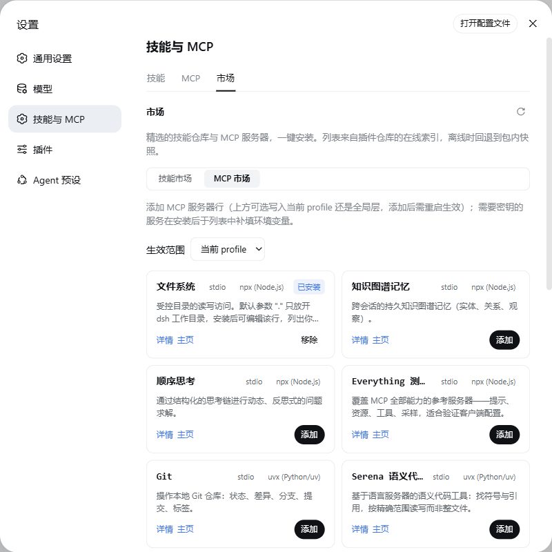

<p align="center">
  
</p>

<h1 align="center">dsh-plugin-capabilities</h1>

<p align="center">
  技能、MCP、其他 Agent 的配置，在 dsh 里一起管理。<br />
  <sub>Your skills and MCP servers, all together.</sub>
</p>

<p align="center">
  <a href="https://www.npmjs.com/package/dsh-plugin-capabilities"></a>
  <a href="https://www.npmjs.com/package/dsh-plugin-capabilities"></a>
  <a href="./LICENSE"></a>
</p>

<p align="center">
  <a href="#安装">安装</a> · <a href="#界面预览">界面预览</a> · <a href="#技能">技能</a> · <a href="#mcp">MCP</a> · <a href="#开发">开发</a>
</p>

---

为 [DeepSeek Harness](https://github.com/deepseek-ai/deepseek-harness) 的设置页增加 **技能与 MCP** 分区。技能目录、项目技能、仓库导入和 MCP 配置，都可以直接在页面维护。

适用于 `dsh web` 及内嵌该 Web UI 的桌面端，已有 dsh 0.1.1 至 0.2.1-alpha 系列运行时的兼容验证。

## 安装

```sh
dsh plugin --profile web add dsh-plugin-capabilities
```

安装并加载后，打开 **设置 → 技能与 MCP**，在「技能」「MCP」「市场」三个标签页中使用。

## 界面预览

<table>
  <tr>
    <td width="50%" align="center">
      <br />
      <sub>技能目录 · 搜索、编辑、开关</sub>
    </td>
    <td width="50%" align="center">
      <br />
      <sub>MCP 服务器 · 配置、导入、检查</sub>
    </td>
  </tr>
</table>

| 你想做什么 | 从哪里开始 |
| :-- | :-- |
| 管理已有技能 | 搜索、按来源筛选、调整调用开关，或打开技能所在目录 |
| 为项目单独配置技能 | 切换工作区，管理项目的 `.dsh/skills` |
| 把已有技能带进来 | 导入文件夹、Markdown 或 ZIP；也可注册本地 / GitHub 仓库 |
| 复用其他 Agent 的配置 | 自动发现技能目录，按需导入 MCP 服务器 |
| 配置 MCP | 添加 stdio / streamable-http 服务器，选择 profile 或全局范围 |
| 找新技能和工具 | 打开市场，查看详情后安装精选条目 |

## 技能

用户技能保存在 `$DSH_HOME/skills`，可直接新建、编辑和删除；保存后由文件监听更新目录，无需重启。从市场或注册仓库安装的技能也支持就地编辑，并保留编辑器未管理的 frontmatter 字段，如 `license`、`allowed-tools`。

每个有文件的技能都有调用开关。关闭后从模型技能目录与 `/` 命令中移除，重新开启恢复默认调用策略。其他 Agent 的技能通过原目录扫描，调整开关也会写回原文件。

<details>
<summary><strong>复用其他 Agent 的技能</strong></summary>

自动扫描已存在的技能目录，并按 Agent 标注来源：Claude Code、Codex、Gemini CLI、Cursor、GitHub Copilot、Windsurf、OpenCode、Trae（含 CN）、Roo Code、Qoder（含 CN）、CodeBuddy、WorkBuddy、OpenClaw 与 CC Switch。

文件留在原目录，改动原地同步；marketplace 等嵌套目录也能发现。安装新 Agent 后，重新挂载技能提供方或重启 dsh 即可纳入扫描。

插件随包附带两条只读技能：来自 [anthropics/skills](https://github.com/anthropics/skills) 的 skill-creator，以及来自 [vercel-labs/skills](https://github.com/vercel-labs/skills) 的 find-skills。它们随插件升级与卸载。

</details>

<details>
<summary><strong>项目技能与文件导入</strong></summary>

顶部工作区选择器列出 dsh 已登记的工作区。选择项目后，目录纳入 `.dsh/skills` 与 `.agents/skills`；其中 `.dsh/skills` 的技能支持就地编辑。切回「全局」恢复默认视图。

「导入技能」支持文件夹、单个 `.md` 文件和不超过 32 MiB 的 ZIP。文件夹既可包含一个技能，也可包含多个技能或散装 Markdown；ZIP 能自动识别 GitHub 仓库的外层目录。

目的地可选用户目录或工作区的 `.dsh/skills`，同名冲突可跳过或覆盖，完成后逐条显示结果。技能按 frontmatter 的 `name` 命名，缺省时由文件夹或文件名归一成 kebab-case，导入后无需重启。

</details>

<details>
<summary><strong>注册本地与 GitHub 技能仓库</strong></summary>

本地目录直接扫描，移除仓库记录不会删除原文件。GitHub 仓库支持 `owner/repo` 或完整 URL，可用 `#分支` 指定分支，通过 tarball 下载到 `DSH_HOME`，无需安装 git。

单技能位于根目录、多个技能分放子目录，或集中在二级目录的布局都能识别。添加与移除仓库会重新挂载扫描提供方，即时更新目录，无需重启。

</details>

## MCP

支持 **stdio** 与 **streamable-http**。添加、编辑、停用、移除，以及从其他 Agent 导入，都在同一页面完成。

| 能力 | 行为 |
| :-- | :-- |
| 两层配置 | 合并展示当前 profile 与全局层，标明所在层和同名覆盖关系；添加与复制可选择目标层 |
| 配置互转 | 表单同步生成 YAML 行与 `mcpServers` JSON，也支持粘贴 JSON 解析回表单 |
| 导入已有服务器 | 扫描 Claude Code、Codex、Cursor 与 Gemini CLI，勾选后写入目标层 |
| 连接前检查 | stdio 检查 PATH 中的命令；HTTP 以短超时 GET 检查地址可达性，不代表完整 MCP 握手成功 |

MCP 配置变更需要重启 dsh。页头「重启」按钮会先确认，再由桌面壳层或独立 Web 服务完成重启，页面恢复后自动刷新。

<details>
<summary><strong>配置保存与导入细节</strong></summary>

服务器行使用 `@deepseek-ai/dsh-mcp-client`。profile 配置仅作用于当前 profile；全局配置写入 `$DSH_HOME/cordis.patch.yml`，对本机所有 profile 生效。

YAML 通过文档树读写，保留其他行与注释。补丁存在语法错误时，页面报告文件路径与行列，不执行写入。

从 Claude Code 导入的 `${VAR}` 环境变量引用会保留为字面值，需要时请在导入后调整。

桌面端重启由壳层管理；独立运行 `dsh web` 时，插件启动替代进程并退出当前进程。重启会中断正在进行的回合。

</details>

## 市场

浏览精选技能仓库和 MCP 服务器，点开条目即可查看技能清单、启动命令、所需环境变量与工具说明。

技能仓库安装后立即进入目录；MCP 条目写入当前选择的配置层，需要密钥的服务器会标出环境变量。已安装条目可以在市场卸载。在线索引不可用时，回退到包内快照。

<details>
<summary><strong>查看技能市场与 MCP 市场截图</strong></summary>

<table>
  <tr>
    <td width="50%" align="center">
      <br />
      <sub>技能市场</sub>
    </td>
    <td width="50%" align="center">
      <br />
      <sub>MCP 市场</sub>
    </td>
  </tr>
</table>

</details>

## 开发

```sh
npm install
npm run typecheck
npm test
npm run build
```

<details>
<summary><strong>本地安装、端到端 smoke 与卸载</strong></summary>

安装本地源码检出，`prepare` 会自动构建 `lib/`：

```sh
dsh plugin --profile web add file:/path/to/dsh-plugin-capabilities
```

端到端 smoke 默认关闭。需要 Node ≥ 22.19，并在同级目录准备已安装依赖的 `deepseek-harness` 源码检出。测试在临时 `DSH_HOME` 中安装插件、启动真实 `dsh web`，验证技能写入、目录监听及 MCP 配置读写。

```sh
# macOS / Linux
DSH_DESKTOP_PLUGIN_SMOKE=1 npm test
```

```powershell
# Windows PowerShell
$env:DSH_DESKTOP_PLUGIN_SMOKE = '1'
npm test
```

卸载本插件：

```sh
dsh plugin --profile web remove dsh-plugin-capabilities
```

</details>

<details>
<summary><strong>工作原理与安全</strong></summary>

服务端注册 `/dsh-plugin-capabilities/*` 路由，并以子插件挂载 filesystem skill provider，为设置页提供实时目录。额外技能根随插件装卸，保持 preset 层的技能发现语义。

GitHub 仓库通过纯 JavaScript tar 读取器解包，不启动子进程；路径逃逸与解包大小受到校验，ZIP 导入也检查路径穿越。

写操作校验技能名、MCP 服务器名与路径，并要求同源 POST。官方桌面壳转发的请求没有 Origin 头时，仅在 Host 与连接对端均为回环地址、没有代理痕迹，且没有跨站 `Sec-Fetch-Site` 标记的条件下放行。

</details>

---

[插件更新工具](https://github.com/qinyre/dsh-plugin-install) · [反馈问题](https://github.com/qinyre/dsh-plugin-capabilities/issues) · [MIT License](./LICENSE)
